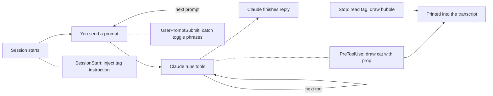
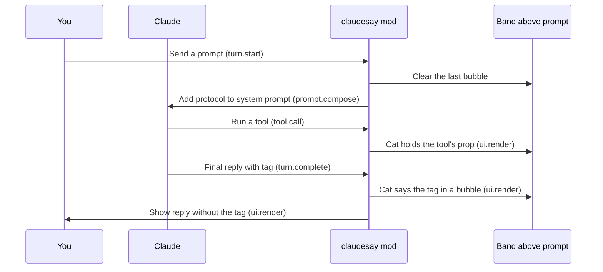
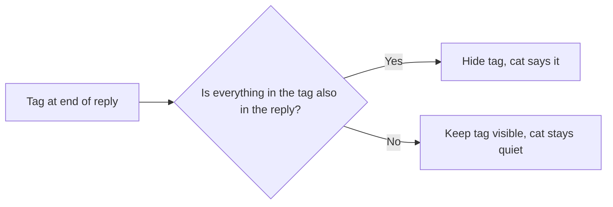

```
 ╭─────────────────────────────────────────────╮
 │ I updated the README and all tests pass. Do │
 │ you want a commit?                          │
 ╰───────┬─────────────────────────────────────╯
         │

      /\\__/\\
     ( ᵕ‿ᵕ  )
   ╭╭: ,,,, :╮╮
   ○ (      ) ○
     (╭....╮)
    (_)    (_)╰~~>
```

If you've spent time in a terminal, you've probably run `cowsay` at least once — the old Unix utility that prints a message inside a speech bubble with a cow underneath. It does nothing useful. That's the point.

`claudesay` is cut from the same cloth. It's a mod for Claude Code that gives the AI assistant a small ASCII cat living just above the prompt. When Claude edits a file, the cat holds a wrench. When it searches for something, the cat holds a magnifying glass. When Claude finishes a reply and has something to say, the cat says the gist of it in a speech bubble.

## Features

- ASCII cat that sits above the prompt and reacts to Claude's actions
- Speech bubbles with a one-line summary of Claude's replies
- Different cat expressions for different moods
- Tools held by the cat depending on the action
- Customizable cat, faces and props
- Three modes — `on`, `tools`, `off` — switchable from `/config` without restarting

## It Started with Hooks

Every Claude Code session follows the same lifecycle. The session starts, you send a prompt, Claude runs zero or more tools, and Claude finishes its reply. Then it waits for your next prompt and the loop repeats. Claude Code's hook system lets you attach shell scripts to points in that loop.

The first versions of `claudesay` were built on those hooks. A `SessionStart` hook told Claude to end its replies with a `<claudesay>` tag, a `UserPromptSubmit` hook caught toggle phrases like "turn on claudesay", a `PreToolUse` hook drew the cat with a prop before each tool call, and a `Stop` hook read the tag and printed the speech bubble. All plain Bash, plus `jq`.



It worked, but hooks can only do so much. They sit outside the UI, so the only way to show the cat was to print it into the transcript as a message. Every reply got its own bubble, and a long session ended up with a transcript full of cats. The raw tag stayed visible in Claude's replies, since a shell script can't touch what the screen draws. Toggling it on and off meant intercepting phrases like "turn on claudesay" and flipping a flag file.

## Why a Mod Is Better

Claude Code now supports mods: TypeScript modules that hook into both Claude's lifecycle and its interface. That's exactly the missing piece. With a mod, `claudesay` can draw the cat in its own spot above the prompt instead of stuffing it into the transcript, and it can hide the tag from the reply on screen. Settings live in `/config`, changes load instantly without restarting the session, and the whole thing is typed and testable instead of a pile of shell scripts.

So version 3 is a rewrite as a single TypeScript module. It hooks into the same lifecycle, plus two places the old hooks couldn't reach: the system prompt and the screen:

- `session.start` reads the cat's look from `character.json`.
- `prompt.compose` adds a short protocol to the system prompt, asking Claude to end conversational replies with a `<claudesay>` tag containing a mood and a summary.
- `turn.start` clears the last bubble when you send a new prompt, and reloads `character.json` so edits show up right away.
- `tool.call` keeps track of which tools are running, so the cat can hold the right prop.
- `turn.complete` reads the tag at the end of Claude's final answer.
- `ui.render` hides the tag from the reply on screen and draws the cat in the band above the prompt.

Here's how one turn plays out:



There's only ever one cat. Each new turn replaces it, so nothing piles up in the transcript. No Bash, no `jq`, no background process. The ASCII art never enters Claude's context — it's drawn by the UI, invisible to the model.

## Keeping the Cat Honest

There's one catch with a summary bubble: it only shows the latest line, and the tag is hidden from the reply on screen. If Claude puts something important *only* in the bubble — a link, a command, a file path — it's gone from view the moment the next turn starts.

So the mod checks each tag before hiding it. If the tag mentions a link, a number, a path, or a command that the reply itself doesn't contain, the tag stays visible in the reply and the cat stays quiet. Same if the tag asks for consent the reply never asked for.



The bubble is a recap, never the only place where something was said.

## Small Token Cost

In the default mode, the protocol adds about 350 tokens to the system prompt. It sits after the cache boundary, so the prompt cache usually absorbs it, and each tag Claude writes is a few output tokens on top. In `tools` mode the cat still holds props but Claude writes no tags, so the cost drops to zero. The rendered art costs nothing either way.

## Moods

The mood in each bubble isn't fixed. Claude picks from a small set — happy, excited, thinking, focused, upset, error — based on what just happened. A successful edit gets a different face than a warning. The happy/excited moods alternate to add some variety.

## Make It Your Own

The cat is only the default. Everything about the character lives in an optional `~/.claude/claudesay/character.json`, and you only write the fields you want to change. The rest falls back to the defaults.

The character is a 3 × 3 grid of cells. The face sits in the top middle, and the side cells are the hands, where props show up:

```text
┌─────┬────────┬─────┐
│ TL  │  TOP   │ TR  │
│     │  FACE  │     │
├─────┼────────┼─────┤
│  L  │  BODY  │  R  │
├─────┼────────┼─────┤
│ BL  │  BOT   │ BR  │
└─────┴────────┴─────┘
```

From there you can:

- Redraw any cell to change the body, or turn the cat into something else entirely
- Swap the faces for each mood, with a list of faces to rotate through
- Pick a prop, a mood and a hand for any tool, MCP tools included
- Resize the grid with `sideWidth`, `centerWidth`, `cellHeight` and `topHeight`

For example, this gives the cat a new focused face and a lightning bolt in its left hand whenever Claude runs a shell command:

```json
{
  "faces": {
    "focused": "( •_•  )"
  },
  "tools": {
    "Bash": { "prop": "⚡", "side": "left" }
  }
}
```

The mod reloads the file at the start of every turn, so changes show up on the next reply without a restart. A broken file doesn't break anything either: the mod skips a bad field and tells you which one, and if the whole file is invalid, it just draws the default cat.

## Why?

Just for fun. It doesn't make Claude smarter. It doesn't save time. It's a cowsay for 2026 — a small piece of personality sitting on top of something you'd be using anyway. The terminal is a pretty sterile place. A cat with a wrench is a small improvement.

The project is on GitHub at [TimJJTing/claudesay](https://github.com/TimJJTing/claudesay).
