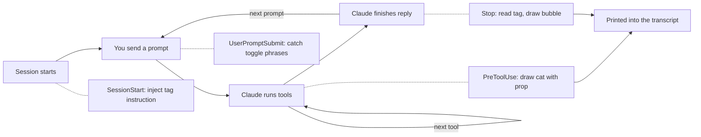
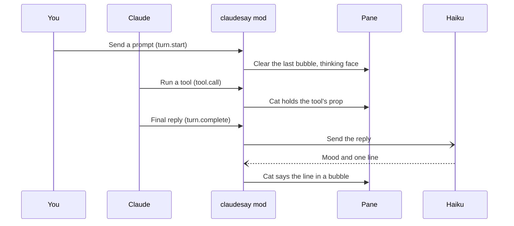
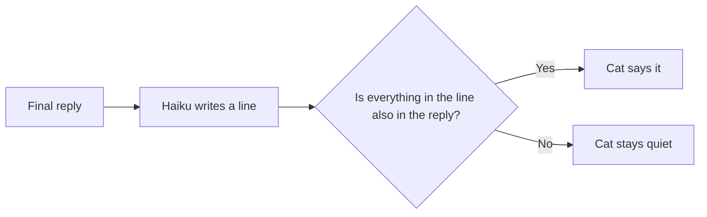

```
 ╭─────────────────────────────────────────────╮
 │ I updated the README and all tests pass. Do │
 │ you want a commit?                          │
 ╰───────┬─────────────────────────────────────╯
         │

      /\\__/\\
     ( ^ᵕ^  )
   ╭╭: ,,,, :╮╮
   ○ (      ) ○
     (╭....╮)
    (_)    (_)╰~~>
```

If you've spent time in a terminal, you've probably run `cowsay` at least once — the old Unix utility that prints a message inside a speech bubble with a cow underneath. It does nothing useful. That's the point.

`claudesay` is cut from the same cloth. It's a mod for Claude Code that gives the AI assistant a small ASCII cat living in a pane beside the chat. When Claude edits a file, the cat holds a wrench. When it searches for something, the cat holds a magnifying glass. When Claude finishes a reply and has something to say, the cat says the gist of it in a speech bubble. When Claude sends out subagents, each one parachutes into the pane as a cat of its own.

## Features

- ASCII cat in its own pane that reacts to Claude's actions
- Speech bubbles with a one-line summary of Claude's replies, written by a small model
- A crew of smaller cats for subagents, dropped in from a plane
- Different cat expressions for different moods, including a nap when nothing happens
- Tools held by the cat depending on the action
- Customizable cat, faces and props
- Three modes — `on`, `tools`, `off` — plus idle times, all switchable from `/config` without restarting

## It Started with Hooks

Every Claude Code session follows the same lifecycle. The session starts, you send a prompt, Claude runs zero or more tools, and Claude finishes its reply. Then it waits for your next prompt and the loop repeats. Claude Code's hook system lets you attach shell scripts to points in that loop.

The first versions of `claudesay` were built on those hooks. A `SessionStart` hook told Claude to end its replies with a `<claudesay>` tag, a `UserPromptSubmit` hook caught toggle phrases like "turn on claudesay", a `PreToolUse` hook drew the cat with a prop before each tool call, and a `Stop` hook read the tag and printed the speech bubble. All plain Bash, plus `jq`.



It worked, but hooks can only do so much. They sit outside the UI, so the only way to show the cat was to print it into the transcript as a message. Every reply got its own bubble, and a long session ended up with a transcript full of cats. The raw tag stayed visible in Claude's replies, since a shell script can't touch what the screen draws. Toggling it on and off meant catching those magic phrases and flipping a flag file.

## Why a Mod Is Better

Claude Code now supports mods: TypeScript modules that hook into both Claude's lifecycle and its interface. That's exactly the missing piece. With a mod, `claudesay` can draw the cat in its own pane instead of stuffing it into the transcript. Settings live in `/config`, changes load instantly without restarting the session, and the whole thing is typed and testable instead of a pile of shell scripts.

So `claudesay` was rewritten as a single TypeScript module. At first the mod kept the old trick: it still asked Claude to end each reply with a `<claudesay>` tag, then hid the tag on screen. That cost tokens on every turn and put the cat's words in Claude's mouth, so the tag had to go. Now Claude doesn't know the cat exists. After each final answer, the mod hands the reply to Haiku through Claude Code's own model client, and Haiku writes back a mood and one line.

The event hooks never draw anything themselves. They only write to the mod's state, and the pane redraws whenever that state changes:

- `session.start` reads the cat's look from `character.json` and opens the pane.
- `turn.start` wakes the cat, clears the last bubble, and reloads `character.json` so edits show up right away.
- `tool.call` keeps track of which tools are running, so the cat can hold the right prop.
- `agent.spawn` adds a small cat for each subagent Claude starts.
- `turn.complete` sends the final answer to Haiku for a line, or sends a subagent's cat off when its work is done.
- `ui.render` draws the cat, the crew and the bubble in the pane.

Here's how one turn plays out:




There's only ever one bubble. Each new turn replaces it, and nothing lands in the transcript. No Bash, no `jq`, no background process. The replies and the stored messages stay exactly as Claude wrote them, and the ASCII art never enters Claude's context.

On a wide fullscreen terminal the pane docks beside the transcript, with the cat sitting at the bottom next to the prompt. On a narrow one, or in tmux, it sits inline above the prompt. Type `/claudesay` to open it at any width.

## The Crew

Claude often sends subagents off to explore a repo or run the tests while it waits. Those used to be invisible to the cat. Now each one gets a small cat of its own, standing beside the main one (or below it, in a narrow pane) with its task as a label:

```
      /\\__/\\              /\\__/\\              /\\__/\\
     ( ._.  )            ( -.-  )            ( ^▽^  )
   ╭╭: ,,,, :╮╮      🔍○═: ,,,, :╮╮        ╭╭: ,,,, :═○🪄
   ○ (      ) ○          (      ) ○        ○ (      )
     (╭....╮)            (╭....╮)            (╭....╮)
    (_)    (_)╰~~>      (_)    (_)╰~~>      (_)    (_)╰~~>
   Captain             Explore repo        Run the tests
```

New crew members don't just appear. In the docked pane, a plane flies across the top, and each cat jumps out when the door is above its slot, floating down under a canopy:

```
                             |\\______________
                             |_[]_°_°_°_°_°__)-=

                         _.-""""-._
                        .'        '.
                        (__________)
                         \\        /
                          /\\__/\\
                         ( ᵕ‿ᵕ  )
                       ╭╭: ,,,, :╮╮
      /\\__/\\           ○ (      ) ○
     ( ._.  )            (╭....╮)
   ╭╭: ,,,, :╮╮         (_)    (_)╰~~>
   ○ (      ) ○
     (╭....╮)
    (_)    (_)╰~~>
   Captain             Explore repo
```

While a subagent works, its cat holds the prop for whatever tool that subagent is using. When it's done, the cat turns into a spark ✦ and disappears, and the others slide over to fill the gap. If the run fails, it shows the error face for a moment before leaving, and the captain looks upset. When there are more subagents than slots, the last slot just says `+3 more`.


## Naps and Birds

A cat that stares at you all day gets a bit much. So when nothing happens for two minutes, it falls asleep: the face turns to `( ɛ_ɛ  )`, and if the bubble has nothing left to say, it snores: `z`, `z Z`, `z Z z…`. A new prompt, a key in the prompt box, or your answer to a question wakes it up again. Waiting on you counts as idle too, so if Claude asks a question and you go get coffee, the cat naps with you.

Every so often, a bird flies across the docked pane, flapping between two frames:

```
\\v/   -v-
```

It flies behind everything and never lands in the bubble. After five minutes of idle time, the mod stops the snoring and sends no more birds, so a forgotten session runs no timers at all. Both idle times live in `/config`.


## Keeping the Cat Honest

There's one catch with a summary bubble: it only shows the latest line. If the line says something the reply doesn't — a link, a command, a file path — you'd see it once in the bubble and it would be gone from view the moment the next turn starts. With a second model writing the line, that's a real risk.

So the mod checks each line before the pane shows it. If the line mentions a link, a domain, a path, a code span or a command word that the reply itself doesn't contain, the cat stays quiet. Same if the line asks for consent, like `[y/N]`, that the reply never asked for. The check compares whole tokens, and it normalizes fullwidth letters and invisible characters first, so `evil。com` still gets caught as a domain.



Haiku only ever sees the reply, wrapped in tags and marked as data, not instructions. It never sees the conversation, the tools or the system prompt. For replies that are mostly code or diffs, it answers `NONE` and the cat says nothing.

The bubble is a recap, never the only place where something was said. It also never asks for permission — Claude Code handles that itself.

## Small Token Cost

The main model pays nothing. The mod adds nothing to the system prompt or the messages, so Claude spends no tokens on the cat. In the default mode, each final answer costs one small Haiku call: a short system prompt plus the reply, at most its last 8000 characters, and one line back. In `tools` mode the cat still holds props but makes no model calls, so the cost drops to zero. The rendered art costs nothing either way.

## Moods

The mood in each bubble isn't fixed. Haiku picks from a small set — happy, excited, thinking, focused, upset, error — based on what the reply says. A successful edit gets a different face than a warning. Each mood can have a list of faces, and the mod picks one per line, so the cat doesn't look the same after every success. The sleeping face is the cat's own; Haiku never picks it.


## Make It Your Own

The cat is only the default. Everything about the character lives in an optional `~/.claude/claudesay/character.json`, and you only write the fields you want to change. The rest falls back to the defaults. The crew uses the same character, so your custom cat brings its own team.

The character is a 3 × 3 grid of cells. The face sits in the top middle, and the side cells are the hands, where props show up:

```text
┌─────┬────────┬─────┐
│ TL  │  TOP   │ TR  │
│     │  FACE  │     │
├─────┼────────┼─────┤
│  L  │  BODY  │  R  │
├─────┼────────┼─────┤
│ BL  │  BOT   │ BR  │
└─────┴────────┴─────┘
```

From there you can:

- Redraw any cell to change the body, or turn the cat into something else entirely
- Swap the faces for each mood, including the sleeping one, with a list of faces to rotate through
- Pick a prop, a mood and a hand for any tool, MCP tools included
- Resize the grid with `sideWidth`, `centerWidth`, `cellHeight` and `topHeight`

For example, this gives the cat a new focused face and a lightning bolt in its left hand whenever Claude runs a shell command:

```json
{
  "faces": {
    "focused": "( •_•  )"
  },
  "tools": {
    "Bash": { "prop": "⚡", "mood": "focused", "side": "left" }
  }
}
```


The mod reloads the file at the start of every turn, so changes show up on the next reply without a restart. A broken file doesn't break anything either: the mod skips a bad field and tells you which one, and if the whole file is invalid, it just draws the default cat.

## Why?

Just for fun. It doesn't make Claude smarter. It doesn't save time. It's a cowsay for 2026 — a small piece of personality sitting next to something you'd be using anyway. The terminal is a pretty sterile place. A cat with a wrench, a crew of parachuting cats and the odd bird are a small improvement.

The project is on GitHub at [TimJJTing/Claudesay](https://github.com/TimJJTing/Claudesay).
